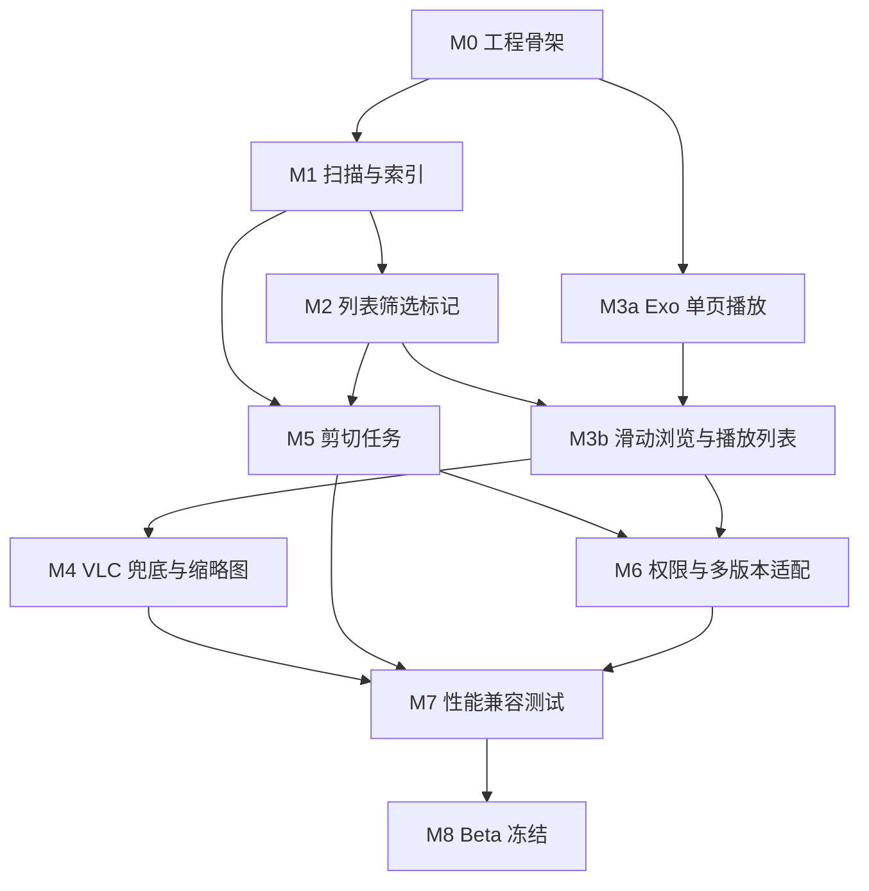

# 过片（Guopian）开发任务清单 V1.0

| 项目 | 内容 |
|------|------|
| 产品 | 过片 Guopian |
| 日期 | 2026-09-28 |
| 状态 | 可排期 |
| 关联 | 需求 V1.0、技术选型及实现细节 V1.0、交互原型说明 V1.0 |
| 人力假设 | Android ×2（A：数据/扫描/任务；B：播放/滑动/缩略图）+ 兼职测试 |
| 总工期 | 约 **8–10 周**（含联调与兼容测试缓冲） |

---

## 0. 读法说明

- **工时**：人天（理想开发日，不含法定假）；已含模块内自测，不含完整回归。
- **优先级**：P0 必须进 V1.0；P1 有余力；P2 不做进本期。
- **依赖**：未满足依赖不得宣称该任务完成。
- **估算粒度**：1 人天 ≈ 1 名 Android 全日有效产出。

### 0.1 角色分工

| 角色 | 代号 | 主责 |
|------|------|------|
| Android 数据/业务 | **A** | SAF、Room、扫描、筛选、标记、剪切、任务、设置 |
| Android 媒体/体验 | **B** | Exo/VLC、滑动播放、手势、缩略图、沉浸式 |
| 测试 | **T** | 样例库、格式矩阵、性能与回归 |

---

## 1. 依赖关系总图



**关键路径：**  
`M0 → M1 → M2 → M3b → M4 → M7 → M8`  
（M5 可与 M3b/M4 并行，但须在 M7 前完成）

---

## 2. 里程碑与工时汇总

| 里程碑 | 内容 | 工时合计 | 日历（2 人并行） |
|--------|------|----------|------------------|
| M0 | 工程骨架 / DI / 导航 / 主题 | 4 人天 | 第 1 周前半 |
| M1 | SAF 根目录 + 扫描入库 + 基础库 | 12 人天 | 第 1–2 周 |
| M2 | 筛选排序 / 标记标签 / 多选 | 10 人天 | 第 3 周 |
| M3 | Exo + 滑动浏览 + PlayerPool | 16 人天 | 第 3–5 周 |
| M4 | VLC 兜底 + 缩略图管线 | 9 人天 | 第 5–6 周 |
| M5 | 剪切/删除任务队列 | 12 人天 | 第 4–6 周（并行） |
| M6 | 权限与 Android 10–15 适配 | 6 人天 | 第 7 周 |
| M7 | 性能 / 格式 / 稳定性 | 10 人天 | 第 7–8 周 |
| M8 | 冻结 / 已知问题 / 文档 | 3 人天 | 第 8–9 周 |
| **缓冲** | 联调、返工、真机差异 | **8 人天** | 嵌入全程 |
| **合计** | | **约 90 人天** | **约 8–10 周** |

> 单人全职 ≈ 14–16 周；不建议 1 人扛播放+扫描双关键路径。

---

## 3. 任务分解（WBS）

### M0 工程骨架（P0）· 4 人天

| ID | 任务 | 角色 | 人天 | 依赖 | 交付物 |
|----|------|------|------|------|--------|
| M0-01 | 创建工程：`com.guopian.app`、Kotlin、Compose、minSdk26/target35 | A | 1 | — | 可安装空壳 |
| M0-02 | 引入 Hilt / Navigation / DataStore / Timber | A | 0.5 | M0-01 | DI 能注入 |
| M0-03 | 包结构按技术文档落地（ui/domain/data/media/work） | A/B | 0.5 | M0-01 | 包边界 README |
| M0-04 | Material3 主题、深色模式、中文字符串表 | B | 0.5 | M0-01 | 主题切换 |
| M0-05 | 底栏 Nav：库/分类/标签/任务/设置 空页 | B | 0.5 | M0-02 | 可切换 |
| M0-06 | 关于页展示「过片 Guopian」版本号 | B | 0.5 | M0-04 | — |
| M0-07 | CI 本地：assembleDebug + 基础 lint | A | 0.5 | M0-01 | 脚本或文档 |

**里程碑验收：** Debug 包启动进主页，五 Tab 可点。

---

### M1 扫描与索引（P0）· 12 人天

| ID | 任务 | 角色 | 人天 | 依赖 | 交付物 |
|----|------|------|------|------|--------|
| M1-01 | Room：RootFolder / Video / Migration v1 | A | 1.5 | M0 | DB 升级可跑 |
| M1-02 | OpenDocumentTree + takePersistableUriPermission | A | 1 | M0 | 根目录可保存 |
| M1-03 | DocumentsContract 子树遍历（非主线程） | A | 2 | M1-02 | 文件枚举 |
| M1-04 | 视频扩展名/MIME 识别 + 相对路径/depth | A | 1 | M1-03 | VideoDraft |
| M1-05 | 批量 upsert + FULL/INCREMENTAL 策略 | A | 1.5 | M1-01,04 | ScanRepository |
| M1-06 | ScanWorker + 通知进度 + 可取消 | A | 1.5 | M1-05 | 后台扫描 |
| M1-07 | 元数据富化队列（时长/分辨率，限并发） | A/B | 1.5 | M1-05 | Enricher |
| M1-08 | 视频库列表：Paging + LazyGrid/List 骨架 | B | 1.5 | M1-05 | 能刷出文件名 |
| M1-09 | 更换根目录（清索引/提示） | A | 0.5 | M1-02,05 | 设置入口 |

**里程碑验收：** 选定深层级目录，扫出视频扁平列表；杀进程后根目录与数据仍在；增量重扫可用。

---

### M2 筛选、标记、多选（P0）· 10 人天

| ID | 任务 | 角色 | 人天 | 依赖 | 交付物 |
|----|------|------|------|------|--------|
| M2-01 | FilterSpec / SortSpec + 动态查询 | A | 2 | M1 | 可筛路径/状态等 |
| M2-02 | 筛选面板 UI + 快捷「只看未整理」 | B | 1.5 | M2-01 | 交互稿对齐 |
| M2-03 | 智能分类：保存/编辑/删除 Filter | A | 1 | M2-01 | SmartFilter 表 |
| M2-04 | 标记状态/星级/颜色/备注 CRUD | A | 1 | M1-01 | MarkUseCase |
| M2-05 | 标签表 + 多对多 + 标签页 UI | A/B | 1.5 | M2-04 | 标签管理 |
| M2-06 | 列表展示相对路径省略 + 完整路径弹层 | B | 0.5 | M1-08 | — |
| M2-07 | 长按多选 / 全选筛选结果 / 底栏 | B | 1.5 | M2-04 | SelectionState |
| M2-08 | 搜索（文件名/路径/备注/标签 LIKE） | A | 1 | M2-01 | 顶栏搜索 |

**里程碑验收：** 按路径关键词筛选后进列表；标记重启仍在；多选数量正确。

---

### M3 播放与滑动浏览（P0）· 16 人天

| ID | 任务 | 角色 | 人天 | 依赖 | 交付物 |
|----|------|------|------|------|--------|
| M3-01 | PlayerEngine 抽象 + Exo 实现 | B | 2 | M0 | 单视频可播 |
| M3-02 | 音轨/字幕/倍速/比例/旋转基础控制 | B | 1.5 | M3-01 | 控制条 |
| M3-03 | PlaylistSession：Filter+Sort → idList | A | 1.5 | M2-01 | 稳定播放列表 |
| M3-04 | SwipeBrowse 路由与进入定位 index | B | 1 | M3-03, M1-08 | 点击进滑动 |
| M3-05 | VerticalPager 页面 + 沉浸式 | B | 1.5 | M3-04 | 全屏页 |
| M3-06 | PlayerPool 预加载 N=1~3（仅 Exo） | B | 2.5 | M3-01,05 | 切换不黑屏 |
| M3-07 | 手势：单击暂停、双击保留、长按 2x、左右 seek | B | 2 | M3-05 | 设置可配双击 |
| M3-08 | 滑动页标记栏与列表状态同步 | A/B | 1.5 | M2-04, M3-05 | 乐观更新+Undo |
| M3-09 | 播完策略 / 进度保存 | B | 1 | M3-01 | 设置项生效 |
| M3-10 | 滑动内隐藏 UI、序号/总数/路径信息 | B | 1 | M3-05 | — |
| M3-11 | 内存降级：超阈值强制 N=1 | B | 0.5 | M3-06 | 日志可观测 |

**里程碑验收：** 筛选结果内上下滑切换 &lt;500ms 体感；双击标记回列表可见；预加载可配。

---

### M4 VLC 兜底（P0，缩略图已取消）· 约 5 人天

> **范围变更（2026-09-28）：不做缩略图。** 下列 M4-05 / M4-06 取消。

| ID | 任务 | 角色 | 人天 | 依赖 | 交付物 |
|----|------|------|------|------|--------|
| M4-01 | 接入 LibVLC AAR / ABI 裁剪 | B | 1.5 | M0 | so 体积可控 |
| M4-02 | VlcPlayerEngine + Surface 生命周期 | B | 2 | M4-01, M3-01 | 独立可播 |
| M4-03 | PlayerRouter：Exo→VLC→外部打开 | B | 1.5 | M4-02 | 不闪退 |
| M4-04 | 当前页才允许 VLC；预加载禁用 VLC | B | 0.5 | M3-06, M4-03 | 规范落地 |
| M4-05 | ~~Coil ThumbFetcher~~ | — | — | — | **取消** |
| M4-06 | ~~缩略图磁盘缓存~~ | — | — | — | **取消** |
| M4-07 | 不支持格式文案 + 尝试软解入口 | B | 0.5 | M4-03 | — |

**里程碑验收：** 硬解失败自动软解；不支持格式有提示不闪退。列表**不要求**缩略图。

---

### M5 剪切与任务（P0）· 12 人天

| ID | 任务 | 角色 | 人天 | 依赖 | 交付物 |
|----|------|------|------|------|--------|
| M5-01 | Task / TaskItem 表与仓库 | A | 1 | M1-01 | — |
| M5-02 | 目标文件夹选择 + 预设最近 | A | 1 | M1-02 | FolderPreset |
| M5-03 | 冲突策略：重命名/跳过/覆盖 | A | 1 | M5-02 | — |
| M5-04 | moveDocument / 流式 copy+校验+删源 | A | 3 | M5-01 | MoveExecutor |
| M5-05 | MoveWorker 单队列 + 通知进度 + 取消 | A | 2 | M5-04 | — |
| M5-06 | 成功后 rebind URI + markStatus=MOVED | A | 1 | M5-04 | 标记不丢 |
| M5-07 | 任务页：进行中/历史/重试/清记录 | B | 1.5 | M5-05 | — |
| M5-08 | 批量删除（系统删除请求协作） | A | 1 | M5-01 | 二次确认 |
| M5-09 | 滑动页单条「剪切到」 | B | 0.5 | M5-05, M3-08 | — |

**里程碑验收：** 100 条剪切；失败项源仍在；成功项目标可播且标记仍在。

---

### M6 权限与系统适配（P0）· 6 人天

| ID | 任务 | 角色 | 人天 | 依赖 | 交付物 |
|----|------|------|------|------|--------|
| M6-01 | 权限说明页 + 分版本请求封装 | A | 1.5 | M0 | — |
| M6-02 | Android 13 READ_MEDIA_VIDEO 路径验证 | A | 1 | M1, M6-01 | 真机 |
| M6-03 | Android 14 部分授权场景降级提示 | A | 1 | M6-02 | — |
| M6-04 | 持久 URI 丢失检测与引导重选 | A | 1 | M1-02 | — |
| M6-05 | 设置：播放偏好/预加载/双击/隐私文案 | B | 1.5 | M3, M4 | — |

**里程碑验收：** 在 10 / 13 / 14 / 15 至少各 1 台设备主路径通过。

---

### M7 性能与兼容（P0）· 10 人天

| ID | 任务 | 角色 | 人天 | 依赖 | 交付物 |
|----|------|------|------|------|--------|
| M7-01 | 准备 5k 样例库 + 格式包（本地资产） | T/A | 1.5 | — | 测试盘 |
| M7-02 | 扫描耗时/增量耗时打点 | A | 1 | M1 | 报告 |
| M7-03 | 滑动切换时延与内存（N=1/3） | B | 2 | M3, M4 | 报告 |
| M7-04 | 格式矩阵：MP4/MKV/MOV/TS/AVI/WebM/RMVB… | T/B | 2 | M4 | 表格 |
| M7-05 | 跨卷剪切、杀进程恢复、空间不足 | T/A | 1.5 | M5 | — |
| M7-06 | Monkey / 长时间滑动标记稳定性 | T | 1 | M3 | — |
| M7-07 | LeakCanary 处理 Player/Activity 泄漏 | B | 1 | M3, M4 | — |

**里程碑验收：** 需求验收总表 + 技术文档性能门禁达标或有书面例外。

---

### M8 Beta 冻结（P0）· 3 人天

| ID | 任务 | 角色 | 人天 | 依赖 | 交付物 |
|----|------|------|------|------|--------|
| M8-01 | 已知问题列表分级 | A/B | 0.5 | M7 | ISSUE.md |
| M8-02 | 版本号/更新说明/关于页 | B | 0.5 | — | — |
| M8-03 | 发布清单：签名、混淆、ABI、权限声明 | A | 1 | M7 | checklist |
| M8-04 | 文档对齐最终行为（若有偏差改需求附录） | A | 1 | — | 变更记录 |

---

### P1 候补（有余力再做）

| ID | 任务 | 人天 | 说明 |
|----|------|------|------|
| P1-01 | 辅助文件夹树入口 | 2 | FR-11 |
| P1-02 | 传统详情播放页 | 2 | |
| P1-03 | 后台播放开关 | 3 | 媒体会话通知 |
| P1-04 | 双指缩放画面 | 1 | |
| P1-05 | 任务暂停/继续 | 2 | |
| P1-06 | FTS 全文检索 | 2 | |
| P1-07 | contentHash 移动强重绑 | 3 | |

### P2 明确不做（V1.0）

多根目录、回收站、重复视频、云同步、转码、AI 识别。

---

## 4. 并行排期示例（双人）

| 周 | A | B |
|----|---|---|
| W1 | M0 + M1-01~04 | M0 UI + M3-01 起步 |
| W2 | M1-05~09 | M1-08 列表 + M3-02 |
| W3 | M2-01~05 | M2-02/06/07 + M3-03 对接 |
| W4 | M5-01~04 | M3-04~07 |
| W5 | M5-05~08 | M3-08~11 + M4-01 |
| W6 | M5-09 + M6 开始 | M4-02~07 |
| W7 | M6 收尾 + M7 扫描/剪切 | M7 滑动/内存/泄漏 |
| W8 | M7 回归 + M8 | M7 格式矩阵 + M8 |

---

## 5. 每日/每周管理节奏

| 节奏 | 内容 |
|------|------|
| 每日站会 10min | 阻塞（权限/真机/VLC）、昨日完成 ID、今日 ID |
| 每周五 Demo | 必须可演示：扫到的片 / 滑得动 / 标得上 / 剪得走（按周递增） |
| 完成定义 DoD | 代码合入 + 自测清单勾选 + 无 P0 崩溃 + 文档字段已对齐 |
| 风险升级 | 阻塞 &gt;1 天升至架构决策（ADR 增补） |

---

## 6. 风险与缓冲使用规则

| 风险 | 缓冲用法 |
|------|----------|
| DocumentTree 真机过慢 | 优先优化 query API；必要时下调「60s」为内部存储目标并写已知问题 |
| VLC 集成超期 | 先上 Exo + 外部打开，VLC 作硬门禁前必补 |
| 剪切跨厂商差异 | 增加真机矩阵，覆盖策略保「失败不删源」 |
| 人力请假 | 砍 P1，不砍 M3/M5 验收项 |

缓冲 **8 人天**默认归关键路径，不提前用于 P1。

---

## 7. 任务跟踪模板（可贴进 Issue）

```text
标题：[M3-06] PlayerPool 预加载
优先级：P0
角色：B
人天：2.5
依赖：M3-01, M3-05
验收：N=1/2/3 可切；非当前 pause；内存日志可查
```

---

## 8. 与文档映射

| 需求 FR | 主要任务 |
|---------|----------|
| FR-01~02 | M1 |
| FR-03~05,07~09 | M2 |
| FR-06,12 | M3 + M4 |
| FR-10,13 | M5 |
| FR-14 | M6-05 |
| 兼容第 7 章 | M4 + M7 |
| NFR 性能 | M7 |

---

**文档结束**

下一份配套：`交互原型说明_V1.0.md`（逐屏）。
