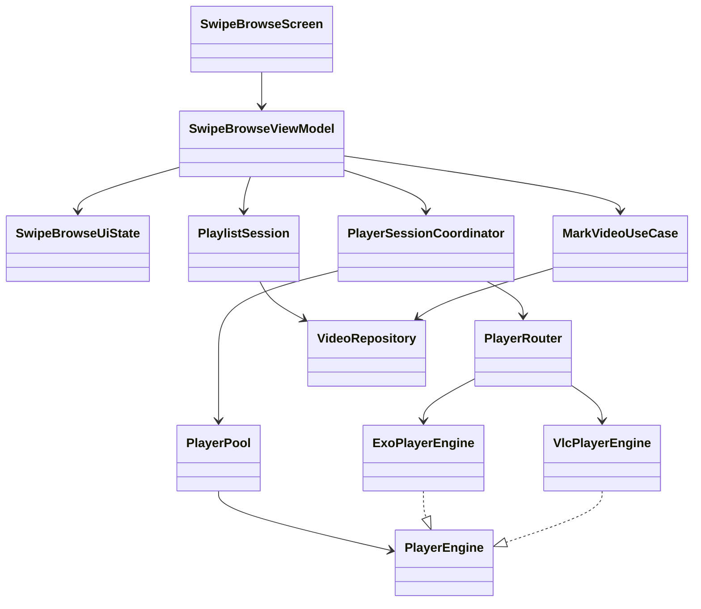
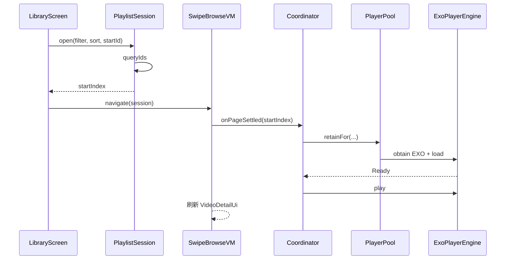
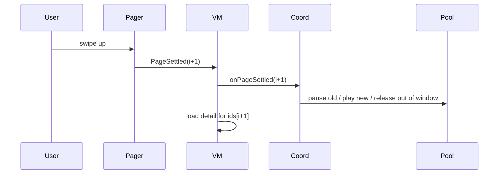
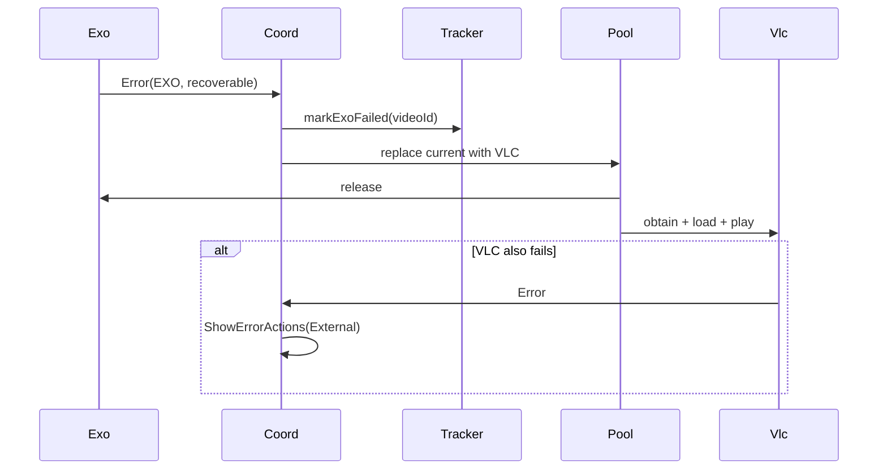

# 过片（Guopian）滑动播放模块 · 类图级详设 V1.0

| 项目 | 内容 |
|------|------|
| 产品 | 过片 Guopian |
| 模块 | `feature:player` / `media:*` / `PlaylistSession` |
| 日期 | 2026-09-28 |
| 状态 | 详设可编码 |
| 关联 | 技术选型 §6–7、交互原型 S20、任务 M3/M4 |
| 包名建议 | `com.guopian.player` / `com.guopian.media` |

---

## 1. 模块目标与边界

### 1.1 目标

实现短视频式垂直滑动浏览：稳定播放列表、预加载、双引擎 failover、手势标记、与列表标记同步。

### 1.2 边界

| 属于本模块 | 不属于本模块 |
|------------|--------------|
| PlayerEngine / Router / Pool | SAF 扫描入库 |
| PlaylistSession（id 列表） | Filter UI 面板 |
| SwipeBrowseScreen / VM | MoveWorker 实现（仅调用剪切入口） |
| 手势与沉浸式控制条 | 缩略图列表加载（Thumb 管线可复用 VLC 截帧工具类） |

### 1.3 非功能约束（硬）

- 预加载 **仅 Exo**；全局 **≤1** 个 VLC 播放实例；
- 池大小 ≤ `2N+1`（N∈[1,3]）；
- 滑动场景内存目标 ≤500MB；超限强制 N=1；
- 主线程禁止 prepare/release 重 IO（release 可 post 到主线程但 stop 在后台）。

---

## 2. 包结构

```
com.guopian.media
  engine/
    PlayerEngine.kt
    EngineId.kt
    PlayerEvent.kt
    MediaRef.kt
    EnginePrefer.kt
  exo/
    ExoPlayerEngine.kt
    ExoPlayerFactory.kt
  vlc/
    LibVlcHolder.kt          // 进程级单例
    VlcPlayerEngine.kt
  router/
    PlayerRouter.kt
    DefaultPlayerRouter.kt
    FailoverTracker.kt
  pool/
    PlayerPool.kt
    PooledPlayer.kt
    PreloadPolicy.kt
  thumb/                     // 可选同模块
    VlcFrameCapture.kt

com.guopian.player
  playlist/
    PlaylistSession.kt
    PlaylistSnapshot.kt
  session/
    PlayerSessionCoordinator.kt
    PlaybackProgressStore.kt
  swipe/
    SwipeBrowseViewModel.kt
    SwipeBrowseUiState.kt
    SwipeBrowseEvent.kt
    MarkUndoStack.kt
  ui/
    SwipeBrowseScreen.kt
    VideoPage.kt
    PlayerHost.kt            // AndroidView 承载 Surface
    SwipeTopBar.kt
    PlayerControlBar.kt
    SwipeMarkBar.kt
    GestureOverlay.kt
  nav/
    SwipeBrowseRoute.kt
```

---

## 3. 类图（逻辑）



---

## 4. 核心类型定义

### 4.1 MediaRef

```kotlin
data class MediaRef(
  val videoId: Long,
  val uri: Uri,
  val mimeType: String?,
  val fileName: String,
  val sizeBytes: Long,
  val durationMs: Long,          // -1 未知
  val engineHint: EngineId?,     // DB 历史提示
)
```

### 4.2 EngineId / EnginePrefer

```kotlin
enum class EngineId { EXO, VLC, EXTERNAL }

enum class EnginePrefer {
  HARD_FIRST,   // Exo → VLC → External
  SOFT_FIRST,   // VLC → External
  EXO_ONLY,     // 预加载专用，失败只回调错误不切 VLC
  EXTERNAL,     // 不创建引擎
}
```

### 4.3 PlayerEvent

```kotlin
sealed interface PlayerEvent {
  data object Idle : PlayerEvent
  data object Buffering : PlayerEvent
  data object Ready : PlayerEvent
  data class Playing(val playing: Boolean) : PlayerEvent
  data class Position(val positionMs: Long, val durationMs: Long) : PlayerEvent
  data object Ended : PlayerEvent
  data class Error(
    val engine: EngineId,
    val code: String,
    val recoverable: Boolean,
    val cause: Throwable?,
  ) : PlayerEvent
  data class TracksChanged(
    val audios: List<TrackInfo>,
    val texts: List<TrackInfo>,
  ) : PlayerEvent
}
```

### 4.4 PlayerEngine

```kotlin
interface PlayerEngine {
  val engineId: EngineId
  val events: SharedFlow<PlayerEvent>  // conflated / replay=1 按实现

  fun attachSurface(surface: SurfaceHost)  // 封装 TextureView/SurfaceView
  fun detachSurface()
  fun load(media: MediaRef, startPositionMs: Long = 0L)
  fun play()
  fun pause()
  fun seekTo(positionMs: Long)
  fun setSpeed(speed: Float)
  fun setMuted(muted: Boolean)
  fun setVideoScaling(mode: ScalingMode)
  fun selectAudio(trackId: String?)
  fun selectText(trackId: String?)
  fun release()
}

enum class ScalingMode { FIT, FILL, STRETCH }
```

### 4.5 PlayerRouter

```kotlin
interface PlayerRouter {
  /**
   * @param allowFailover 预加载传 false（EXO_ONLY）
   */
  suspend fun obtain(
    media: MediaRef,
    prefer: EnginePrefer,
  ): PlayerHandle
}

class PlayerHandle(
  val engine: PlayerEngine,
  val assignedEngine: EngineId,
)
```

**DefaultPlayerRouter 职责：**

1. 读设置 `playerPrefer` + `media.engineHint`；
2. `FailoverTracker`：会话内 `videoId → failedExo`；
3. 创建引擎（经 Factory）；
4. 不在此监听错误；错误由 Coordinator 订阅后决定是否 `replaceWithVlc`。

### 4.6 FailoverTracker

```kotlin
@ActivityRetainedScoped  // 或跟随 PlaylistSession 生命周期
class FailoverTracker {
  private val exoFailedIds = mutableSetOf<Long>()
  fun markExoFailed(videoId: Long)
  fun shouldSkipExo(videoId: Long): Boolean
  fun clearSession()
}
```

### 4.7 PlayerPool

```kotlin
class PlayerPool(
  private val router: PlayerRouter,
  private val policy: PreloadPolicy,
) {
  private val map = mutableMapOf<Int, PooledPlayer>() // pageIndex → player

  suspend fun retainFor(
    settledIndex: Int,
    playlistSize: Int,
    mediaAt: suspend (Int) -> MediaRef,
  )
  fun get(index: Int): PooledPlayer?
  fun releaseAll()
}

class PooledPlayer(
  val pageIndex: Int,
  val handle: PlayerHandle,
  var media: MediaRef,
)
```

**PreloadPolicy：**

```kotlin
data class PreloadPolicy(
  val radius: Int,                 // N
  val maxPlayers: Int = radius * 2 + 1,
  val largeFileBytes: Long = 1L shl 30,
  val forceRadiusOneUnderBytes: Long = 500L * 1024 * 1024, // 进程监控阈值触发
)
```

**retainFor 算法：**

```text
keep = [settled-N, settled+N] ∩ [0, size)
release map.keys - keep
for i in keep:
  if i !in map:
    prefer = if (i == settled) HARD_FIRST(按设置) else EXO_ONLY
    handle = router.obtain(mediaAt(i), prefer)
    map[i] = PooledPlayer(i, handle, media)
    handle.engine.load(...)
  if i == settled: play() else pause()
若 settled 页需要 VLC failover：
  先 release 该 index 的 Exo，再 obtain SOFT/VLC，
  并保证全局仅此一个 VLC（release 其他页若误持有 VLC——理论上不应有）
```

### 4.8 PlaylistSession

```kotlin
@ActivityRetainedScoped
class PlaylistSession(
  private val videoRepository: VideoRepository,
) {
  data class Snapshot(
    val sessionId: String,
    val filter: FilterSpec,
    val sort: SortSpec,
    val ids: LongArray,          // 稳定有序
    val randomSeed: Long?,
    val createdAt: Long,
  )

  private var snapshot: Snapshot? = null

  /** 从库页进入滑动前调用；同 filterHash 可复用 */
  suspend fun open(
    filter: FilterSpec,
    sort: SortSpec,
    startVideoId: Long,
  ): OpenResult  // index + snapshot

  fun current(): Snapshot?
  fun idAt(index: Int): Long?
  fun indexOf(videoId: Long): Int
  fun size(): Int
  fun close()
}

data class OpenResult(val snapshot: Snapshot, val startIndex: Int)
```

**构建 ids：**

```kotlin
videoRepository.queryIds(filter, sort, seed) // 单次查询，禁止边滑边改 filter
```

### 4.9 PlayerSessionCoordinator

```kotlin
class PlayerSessionCoordinator(
  private val pool: PlayerPool,
  private val router: PlayerRouter,
  private val progressStore: PlaybackProgressStore,
  private val failoverTracker: FailoverTracker,
  private val settings: SettingsRepository,
) {
  private var settledIndex: Int = -1
  private val scope: CoroutineScope

  fun bind(scope: CoroutineScope)
  fun onPageSettled(index: Int, session: PlaylistSession.Snapshot)
  fun onHostPaused()
  fun onHostResumed()
  fun onHostDestroyed()
  fun failoverCurrentToVlc(media: MediaRef)
  fun openExternal(media: MediaRef)

  val overlayEvents: SharedFlow<CoordinatorEvent>
}

sealed interface CoordinatorEvent {
  data class ShowErrorActions(val media: MediaRef, val message: String) : CoordinatorEvent
  data object RequestNext : CoordinatorEvent
  data class EngineChanged(val engineId: EngineId) : CoordinatorEvent
}
```

**订阅当前引擎 Error：**

```text
if prefer HARD && engine==EXO && recoverable/decoder → failoverCurrentToVlc
else if VLC fail → ShowErrorActions(External)
Ended → 按 endBehavior：RequestNext / LOOP seek0 / STOP
```

### 4.10 SwipeBrowseViewModel

```kotlin
data class SwipeBrowseUiState(
  val sessionId: String = "",
  val currentIndex: Int = 0,
  val total: Int = 0,
  val video: VideoDetailUi? = null,      // 文件名、路径、标记等
  val isPlaying: Boolean = true,
  val positionMs: Long = 0,
  val durationMs: Long = 0,
  val speed: Float = 1f,
  val uiVisible: Boolean = true,
  val engineLabel: String? = null,       // Debug/失败时
  val endOfListHint: String? = null,
)

sealed interface SwipeBrowseEvent {
  data object Back : SwipeBrowseEvent
  data object TogglePlay : SwipeBrowseEvent
  data object ToggleUi : SwipeBrowseEvent
  data object DoubleTapMark : SwipeBrowseEvent
  data class SetMarkStatus(val status: MarkStatus) : SwipeBrowseEvent
  data class SetStar(val star: Int) : SwipeBrowseEvent
  data class SetColor(val color: String?) : SwipeBrowseEvent
  data class SetNote(val note: String) : SwipeBrowseEvent
  data class ApplyTags(val tagIds: Set<Long>) : SwipeBrowseEvent
  data object UndoMark : SwipeBrowseEvent
  data class Seek(val positionMs: Long) : SwipeBrowseEvent
  data class SetSpeed(val speed: Float) : SwipeBrowseEvent
  data object SpeedBoostPress : SwipeBrowseEvent
  data object SpeedBoostRelease : SwipeBrowseEvent
  data class PageSettled(val index: Int) : SwipeBrowseEvent
  data object SeekForwardGesture : SwipeBrowseEvent
  data object SeekBackwardGesture : SwipeBrowseEvent
  data object OpenCutTo : SwipeBrowseEvent
  data object Delete : SwipeBrowseEvent
  data object Share : SwipeBrowseEvent
  data object TrySoftDecode : SwipeBrowseEvent
  data object OpenExternal : SwipeBrowseEvent
}
```

**依赖注入：** `PlaylistSession`, `PlayerSessionCoordinator`, `MarkVideoUseCase`, `MarkUndoStack`, `SettingsRepository`, `SavedStateHandle(startVideoId, filterSessionKey)`。

### 4.11 MarkUndoStack

```kotlin
class MarkUndoStack(private val capacity: Int = 20) {
  data class Entry(val videoId: Long, val before: MarkSnapshot, val after: MarkSnapshot)
  fun push(...)
  fun pop(): Entry?
}
```

---

## 5. UI 组件职责

| 类/Composable | 职责 |
|---------------|------|
| `SwipeBrowseScreen` | 收集 state、Pager、对接系统返回 |
| `VideoPage` | 单页：PlayerHost + 错误占位 |
| `PlayerHost` | `AndroidView` 绑定 Surface；页不可见时 `detach` 策略与池协同 |
| `GestureOverlay` | 单击/双击/长按/水平 seek；不拦截垂直 Pager |
| `SwipeTopBar` | 返回、文件名、路径、序号 |
| `PlayerControlBar` | 进度、倍速、字幕等 |
| `SwipeMarkBar` | 状态与标记入口 |

**Pager 参数建议：**

```kotlin
VerticalPager(
  state = pagerState,
  beyondViewportPageCount = 0, // 预加载由 PlayerPool 管，不靠 Compose 多组合播放器
  key = { session.ids[it] },
)
```

`LaunchedEffect(pagerState.settledPage) { vm.onEvent(PageSettled(it)) }`

---

## 6. 时序图

### 6.1 进入滑动



### 6.2 上滑切换



### 6.3 Exo 失败 failover



---

## 7. 生命周期矩阵

| 生命周期 | 行为 |
|----------|------|
| `ON_PAUSE` | 当前 pause；可选释放 keep 外已空 |
| `ON_STOP` | 默认 `pool.releaseAll()`，记 progress |
| `ON_START` | `onPageSettled` 重建池 |
| 旋转 | VM + PlaylistSession 保留；Pager 跳回 index；seek progress |
| 离开滑动 | `session` 可保留至返回库；`FailoverTracker.clear` 可选保留 |
| 进程被杀 | 仅 progress DB；池全无 |

---

## 8. 线程与调度

| 操作 | Dispatcher |
|------|------------|
| Room 查 detail / mark | IO |
| Router.obtain / load | Main（Exo 要求）+ 内部异步 prepare |
| release | Main 调用引擎 API |
| 水平 seek 计算 | Main |
| 内存采样 | Default，1s 节流 |

---

## 9. 错误码（本模块）

| Code | 含义 | UI |
|------|------|-----|
| PLAY_EXO_FAIL | Exo 错误 | 自动切兼容或提示中 |
| PLAY_VLC_FAIL | VLC 错误 | 其他应用打开 |
| PLAY_SURFACE_LOST | Surface 丢失 | 静默重建 |
| PLAY_URI_DENIED | 权限失效 | 引导重选根目录 |
| PLAY_UNSUPPORTED | 明确不支持 | 文案+外部打开 |

---

## 10. 单测清单（模块级）

| 用例 | 类型 |
|------|------|
| PlaylistSession indexOf/startId 不在列表 | 单测 |
| PreloadPolicy keep 集合边界（0、末尾） | 单测 |
| FailoverTracker 跳过 Exo | 单测 |
| MarkUndoStack 溢出 | 单测 |
| Coordinator Ended → RequestNext | 单测 mock engine |
| Pool retain 释放越界页 | 单测 |

---

## 11. 实现顺序（模块内）

1. `MediaRef` + `ExoPlayerEngine` 单页可播  
2. `PlaylistSession` + 路由进入  
3. `VerticalPager` 无预加载切换  
4. `PlayerPool` N=1  
5. 手势与标记  
6. `PlayerRouter` + VLC failover  
7. 进度/播完策略/内存降级  

对齐任务：**M3-01 → M3-11 → M4-02~04**。

---

## 12. 编码禁令（Code Rules）

1. 禁止多页共享同一个未 `stop` 的 `ExoPlayer` 实例；  
2. 禁止预加载路径创建 `VlcPlayerEngine`；  
3. 禁止在滑动页修改全局 Filter（必须退出重建 Session）；  
4. 禁止在 `bind` Surface 前 `play`；  
5. 禁止忽略 `FLAG_GRANT_READ_URI_PERMISSION` 打开外部。  

---

**文档结束**

配套测试见：`测试用例矩阵_V1.0.md`。
